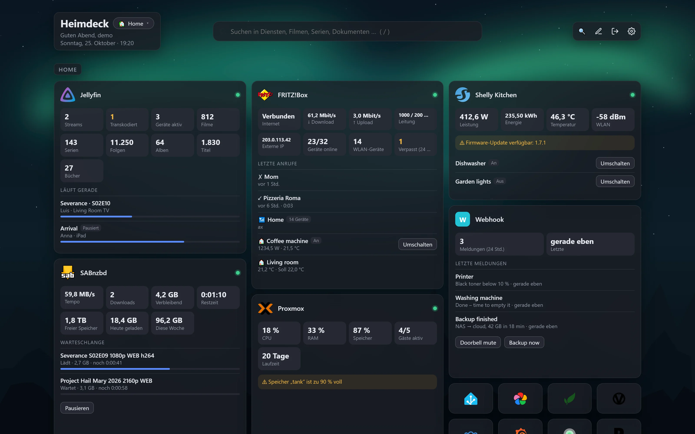

<p align="center">
  
</p>

<h1 align="center">Heimdeck</h1>

<p align="center">
  Ein schlichtes Dashboard für deinen Home-Server – so einfach wie Heimdall, aber mit Live-Daten, einer gemeinsamen Suche über alle Dienste und Aktionen direkt auf den Kacheln.
</p>

<p align="center">
  <a href="https://blum.ing/heimdeck/"></a>
</p>

<p align="center">
  <a href="README.md">English</a> · <b>Deutsch</b>
</p>


<p align="center"><sub>Screenshot mit Demo-Daten</sub></p>

## Das kann Heimdeck

- **Alles in der Oberfläche** – keine YAML-Dateien. Kacheln hinzufügen, verschieben und bearbeiten per Klick und Drag & Drop – oder frei auf einem Raster platzieren und in der Größe ändern.
- **Findet deine Dienste** – liest deine Docker-Container und (wenn verbunden) deine Proxmox-VMs und LXC-Container aus und schlägt Kacheln mit Icon, Adresse und Dienst-Typ vor.
- **Live-Daten** – Download-Warteschlangen, laufende Streams, offene Anfragen, gestörte Indexer, Energiefluss, Anruflisten und mehr für mehr als 40 Dienste. Pro Kachel wählbar, welche Werte sie zeigt.
- **Aktionen** – Jellyseerr-Anfragen genehmigen, SABnzbd oder AdGuard pausieren, Lademodus in evcc wechseln, Smart-Home-Geräte in Home Assistant, ioBroker, Shelly oder der FRITZ!Box schalten, WLED-Presets wechseln, UniFi-Geräte neu starten, Webhooks aufrufen …
- **Eine Suche** (Taste `/`) – Kacheln, Medienbibliotheken, Dokumente, Fotos, Spiele, Dateien, Smart-Home-Geräte, DNS-Abfragen und mehr in einem Suchfeld: als großes Fenster mit Filtern, Vorschau und Tastatursteuerung, als Spalte pro Dienst oder als kompakte Liste. Dazu weitere Tastenkürzel, alle änderbar.
- **Themes** – 21 Stück: klassische Paletten, verspielte wie Neon City, Luna 2001, Studio oder Flüssigglas und Festtags-Themes für Silvester, Ostern, Halloween, Advent und Weihnachten, die sich zu ihren Tagen selbst einschalten – mit Feuerwerk, Schnee oder Fledermäusen hinter den Kacheln. Dazu Ecken, Glas- oder massive Kacheln, Schrift und Abstände; pro Dashboard ein eigenes Theme.
- **Verfügbarkeit und Benachrichtigungen** – jeder Dienst wird jede Minute geprüft, mit Verlauf über 24 Stunden oder 3 Tage. Ausfälle werden per Discord, ntfy, Telegram oder Browser gemeldet.
- **Zuhause oder unterwegs** – jede Kachel kann eine lokale und eine öffentliche Adresse haben; Heimdeck nimmt automatisch die richtige.
- **Eigene API und Webhooks** – jede JSON-Schnittstelle wird zur Live-Kachel mit Werten, Liste und Knöpfen, oder Skripte schicken Meldungen an eine Kachel.
- **Mehrere Dashboards**, ausgeblendete oder per Passwort geschützte Gruppen, Hintergrundbild pro Dashboard.
- **Umstieg von Heimdall** – Heimdall-Export importieren; bekannte Dienste werden zu Live-Kacheln.
- **Deutsch und Englisch**, sicher von Haus aus (Passwörter mit bcrypt, API-Keys mit AES-256 verschlüsselt und nie im Browser), mit Debug-Modus, wenn etwas nicht klappt.
- **Ein kleines Image** für amd64 und arm64 (Raspberry Pi, NAS).


<p align="center"><sub>Dasselbe Dashboard in Heimdeck Dunkel, Studio, Flüssigglas, Neon City, Luna 2001 und Halloween</sub></p>

<details>
<summary><b>Weitere Screenshots</b></summary>

**Eine Suche über alle Dienste** (Taste `/`) – Filter, Tastatursteuerung und eine Vorschau mit den Knöpfen des Treffers


**Einstellungen** – Seitenleiste mit Bereichen, eigene Suche, alles wird sofort gespeichert


**Auf dem Handy** – das freie Raster fließt: Kacheln werden so hoch wie nötig, Links zu Icons

<p align="center"></p>

**Ein komplettes Dashboard** mit Smart Home, Netzwerk, Schnellzugriff und der Verfügbarkeits-Übersicht


<sub>Alle Screenshots mit Demo-Daten, Oberfläche auf Englisch.</sub>
</details>

## Schnellstart (Docker Compose)

`docker-compose.yml` anlegen:

```yaml
services:
  heimdeck:
    image: ghcr.io/mrluigi938/heimdeck:latest
    container_name: heimdeck
    restart: unless-stopped
    ports:
      - "3000:3000"
    volumes:
      - ./data:/data
      # optional: Container automatisch erkennen (nur lesend)
      - /var/run/docker.sock:/var/run/docker.sock:ro
    environment:
      - TZ=Europe/Berlin
```

```sh
docker compose up -d
```

Dann `http://<server>:3000` öffnen, Benutzer anlegen und auf 🐳 klicken, um deine Container hinzuzufügen. Fertig.

**Weitere Installationsarten** – ohne Docker auf Debian, Ubuntu und Raspberry Pi OS, als Proxmox-LXC-Container oder als einzelnes Programm: siehe [Installationsanleitung](docs/de/installation.md).

## Anleitungen

| | |
|---|---|
| [Installation](docs/de/installation.md) | Docker Compose, Debian/Ubuntu, Proxmox-LXC, Programmdatei, Aktualisieren, Einstellungen, Reverse Proxy |
| [Benutzung](docs/de/benutzung.md) | Umstieg von Heimdall, zuhause/unterwegs, Benachrichtigungen, Docker-Labels, Icons, Sicherung, Fehlersuche, Tastenkürzel, Tipps |
| [Unterstützte Dienste](docs/de/dienste.md) | Alle Integrationen, Proxmox verbinden, Docker-Kachel, Kachel „Eigene API“ |
| [Entwicklung](docs/de/entwicklung.md) | Selbst bauen, eigene Integration hinzufügen |

## Unterstützte Dienste (Auszug)

Jellyfin · Plex · Emby · Jellyseerr/Overseerr · Sonarr · Radarr · Lidarr · Readarr · Bazarr · Prowlarr · Immich · PhotoPrism · Audiobookshelf · Kavita · Komga · Navidrome · RomM · Tdarr · Stash · SABnzbd · NZBGet · qBittorrent · Transmission · Deluge · MeTube · Tubesy · Paperless-ngx · Nextcloud · AdGuard Home · Pi-hole · OPNsense · FRITZ!Box · UniFi · UniFi Protect · Speedtest Tracker · Anubis · Docker · Proxmox VE · openmediavault · Home Assistant · ioBroker · Shelly · evcc · WLED · Norish · Webhooks · beliebige JSON-API

→ [Vollständige Liste mit Live-Daten, Suche und Aktionen](docs/de/dienste.md)

## Lizenz

Copyright © 2026 Luis Blum

Heimdeck ist freie Software unter der [GNU Affero General Public License v3.0](LICENSE). Du darfst es nutzen, verändern und weitergeben – auch kommerziell –, solange veränderte Versionen, auch wenn sie als Webdienst angeboten werden, unter derselben Lizenz samt Quellcode veröffentlicht werden.

Heimdeck wurde mit Unterstützung von KI entwickelt ([Claude](https://claude.ai) von Anthropic).
