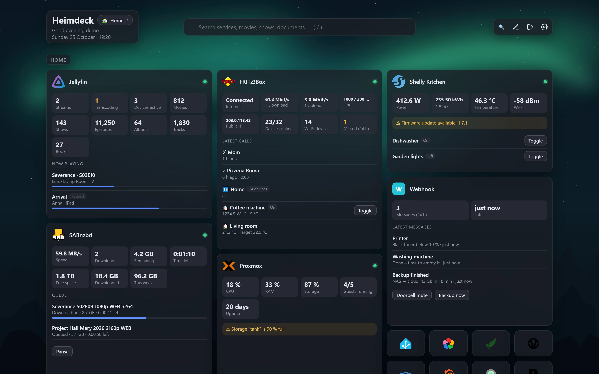
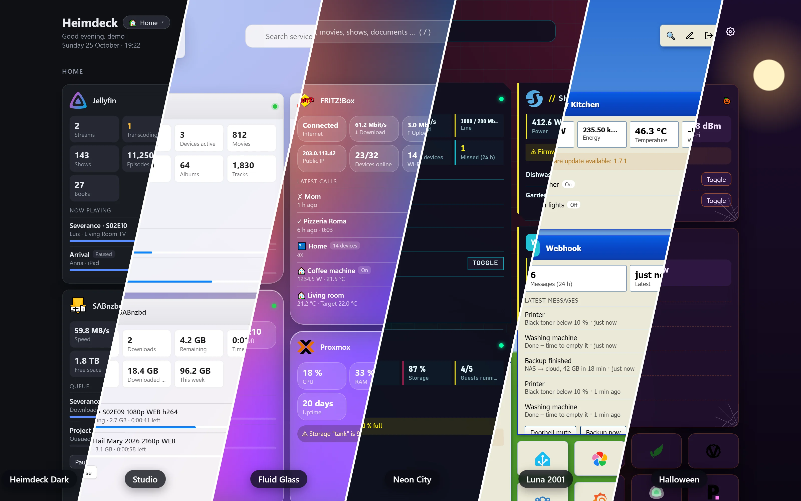
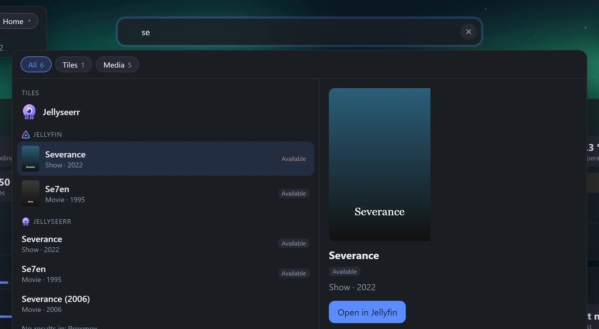
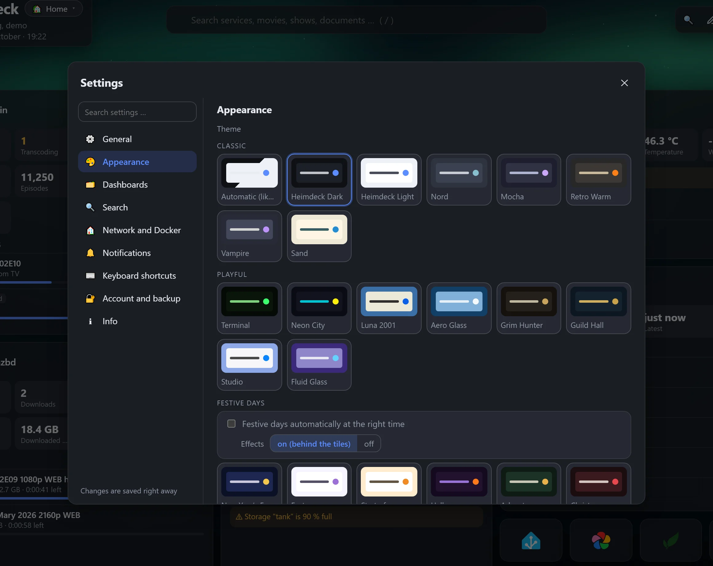
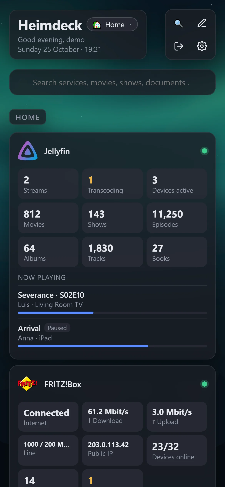

<p align="center">
  
</p>

<h1 align="center">Heimdeck</h1>

<p align="center">
  A simple dashboard for your home server – as easy as Heimdall, but with live data, one search across all your services and actions right on the tiles.
</p>

<p align="center">
  <a href="https://blum.ing/heimdeck/"></a>
</p>

<p align="center">
  <b>English</b> · <a href="README.de.md">Deutsch</a>
</p>


<p align="center"><sub>Screenshot with demo data</sub></p>

## Highlights

- **Everything in the UI** – no YAML. Add, move and edit tiles by click and drag & drop – or place and resize them freely on a grid.
- **Finds your services** – reads your Docker containers and (once connected) your Proxmox VMs and LXC containers and suggests tiles with icon, address and service type.
- **Live data** – download queues, active streams, pending requests, broken indexers, energy flow, call lists and more for more than 40 services. Choose per tile which values it shows.
- **Weather, calendar, news and system load** – info tiles without a service of their own: the forecast for your place, your iCal calendars together with the next episodes and films from Sonarr and Radarr, RSS feeds and the load of the Heimdeck host.
- **Actions** – approve Jellyseerr requests, pause SABnzbd or AdGuard, switch the evcc charge mode, toggle Home Assistant, ioBroker, Shelly or FRITZ!Box smart-home devices, switch WLED presets, restart UniFi devices, call webhooks …
- **One search** (press `/`) – tiles, media libraries, documents, photos, games, files, smart-home devices, DNS queries and more in a single search box: as a large window with filters, preview and keyboard control, as one column per service or as a compact list. More keyboard shortcuts, all changeable.
- **Themes** – 21 of them: classic palettes, playful ones like Neon City, Luna 2001, Studio or Fluid Glass, and festive themes for New Year's Eve, Easter, Halloween, Advent and Christmas that switch themselves on for their days, with fireworks, snow or bats behind the tiles. Corners, glass or solid tiles, font and spacing on top; a theme of its own per dashboard.
- **Uptime and alerts** – every service is checked once a minute, with a 24 h / 3 day history. Outages are reported via Discord, ntfy, Telegram or browser notifications.
- **Home or away** – each tile can have a local and a public address; Heimdeck picks the right one automatically.
- **Custom API and webhook tiles** – turn any JSON endpoint into a live tile with values, a list and buttons, or let scripts post messages to a tile.
- **For the whole household** – everyone gets their own account and dashboards (invitation link or created by you), dashboards can be shared view-only, and external accounts stay out of your home network. Login with **SSO** through Authentik, Authelia, Keycloak or any other OpenID Connect provider.
- **Multiple dashboards**, hidden or password-protected groups, background images per dashboard, a jump to any group, and tiles that open the service's app on phones.
- **Easy switch from Heimdall** – import the Heimdall export file; known services become live tiles.
- **English and German**, secure by default (bcrypt passwords, AES-256 encrypted API keys that never reach the browser), with a debug mode when something does not work.
- **One small image** for amd64 and arm64 (Raspberry Pi, NAS).


<p align="center"><sub>The same dashboard in Heimdeck Dark, Studio, Fluid Glass, Neon City, Luna 2001 and Halloween</sub></p>

<details>
<summary><b>More screenshots</b></summary>

**Search across all services** (press `/`) – filters, keyboard control and a preview with the hit's buttons



**Settings** – a sidebar with areas, a search of its own, everything saved right away



**On the phone** – the free grid flows: tiles take the height they need, links become icons

<p align="center"></p>

<sub>All screenshots use demo data.</sub>
</details>

## Quick start (Docker Compose)

Create a `docker-compose.yml`:

```yaml
services:
  heimdeck:
    image: ghcr.io/mrluigi938/heimdeck:latest
    container_name: heimdeck
    restart: unless-stopped
    ports:
      - "3000:3000"
    volumes:
      - ./data:/data
      # optional: let Heimdeck discover your containers (read-only)
      - /var/run/docker.sock:/var/run/docker.sock:ro
    environment:
      - TZ=Etc/UTC   # your time zone, e.g. America/New_York
```

```sh
docker compose up -d
```

Open `http://<your-server>:3000`, create your user and click 🐳 to add your containers. Done.

**Other ways to install** – without Docker on Debian, Ubuntu and Raspberry Pi OS, as a Proxmox LXC container, or as a single binary: see the [installation guide](docs/installation.md).

## Documentation

| | |
|---|---|
| [Installation](docs/installation.md) | Docker Compose, Debian/Ubuntu, Proxmox LXC, binary, updating, configuration, reverse proxy |
| [Usage](docs/usage.md) | Moving from Heimdall, home/away, notifications, Docker labels, icons, backup, troubleshooting, keyboard shortcuts, tips |
| [Supported services](docs/services.md) | All integrations, connecting Proxmox, the Docker tile, the custom API tile |
| [Development](docs/development.md) | Building from source, adding an integration |

## Supported services (excerpt)

Jellyfin · Plex · Emby · Jellyseerr/Overseerr · Sonarr · Radarr · Lidarr · Readarr · Bazarr · Prowlarr · Immich · PhotoPrism · Audiobookshelf · Kavita · Komga · Navidrome · RomM · Tdarr · Stash · SABnzbd · NZBGet · qBittorrent · Transmission · Deluge · MeTube · Tubesy · Paperless-ngx · Nextcloud · AdGuard Home · Pi-hole · OPNsense · FRITZ!Box · UniFi · UniFi Protect · Speedtest Tracker · Anubis · Docker · Proxmox VE · openmediavault · Home Assistant · ioBroker · Shelly · evcc · WLED · Norish · webhooks · any JSON API

→ [Full list with live data, search and actions](docs/services.md)

## License

Copyright © 2026 Luis Blum

Heimdeck is free software under the [GNU Affero General Public License v3.0](LICENSE). You may use, change and share it – also commercially – as long as changed versions, including ones offered as a web service, are published under the same license with their source code.

Heimdeck was built with the help of AI ([Claude](https://claude.ai) by Anthropic).
