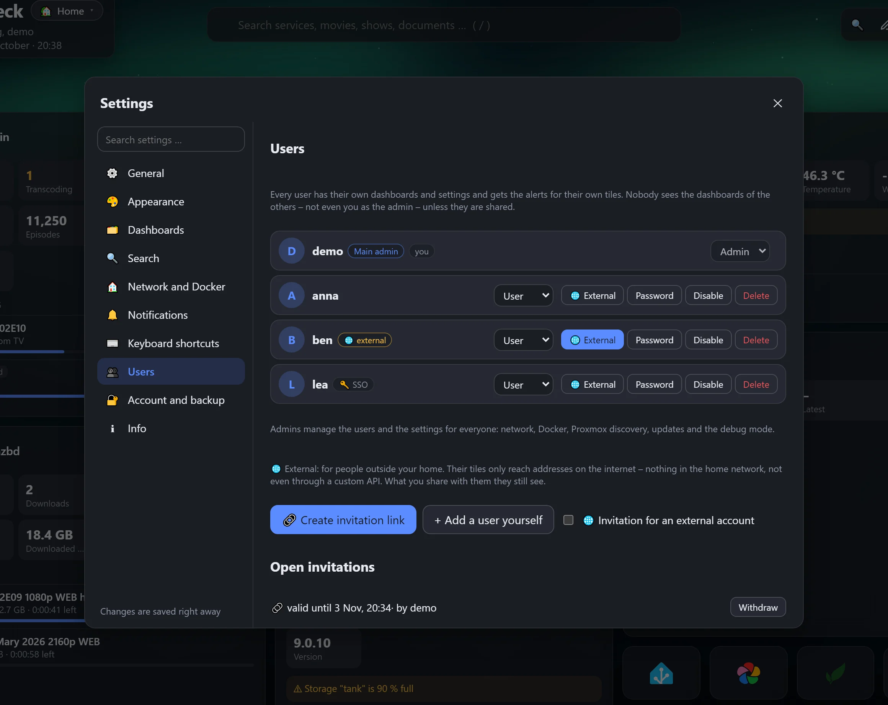
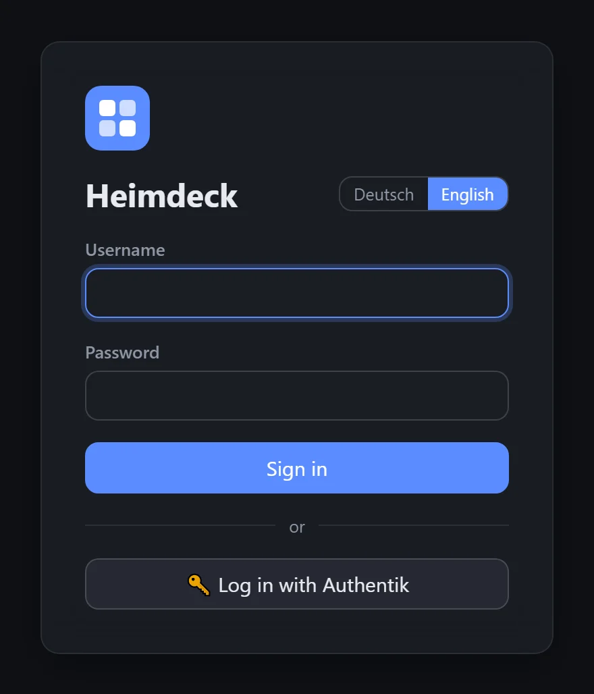

# Benutzung

[← Zurück zur Übersicht](../../README.de.md) · [English](../usage.md)

- [Umstieg von Heimdall](#umstieg-von-heimdall)
- [Dashboards und Gruppen](#dashboards-und-gruppen)
- [Mehrere Benutzer](#mehrere-benutzer)
- [Zu einer Gruppe springen](#zu-einer-gruppe-springen)
- [Auf dem Handy die App öffnen](#auf-dem-handy-die-app-öffnen)
- [Zuhause oder unterwegs](#zuhause-oder-unterwegs)
- [Suche](#suche)
- [Benachrichtigungen](#benachrichtigungen)
- [Docker-Labels](#docker-labels)
- [Icons](#icons)
- [Sicherung](#sicherung)
- [Passwort vergessen?](#passwort-vergessen)
- [Tipps](#tipps)

## Umstieg von Heimdall

1. In Heimdall: Einstellungen → **Exportieren** – das lädt `HeimdallExport.json` herunter.
2. In Heimdeck: auf der Startseite **Von Heimdall übernehmen** (oder Einstellungen → Konto und Sicherung → Importieren) und die Datei wählen.

Tags werden zu Gruppen, Kacheln ohne Tag landen in der Gruppe „Heimdall“. Dienste, die Heimdeck kennt (Sonarr, Radarr, Jellyfin, Nextcloud, AdGuard, Proxmox …), werden als Live-Kachel übernommen – mit API-Key, Benutzer und Passwort aus Heimdall sowie der „Override URL“ als interne Adresse.

## Dashboards und Gruppen

- **Mehrere Dashboards**, z. B. „Privat“ und „Arbeit“: oben neben dem Titel umschalten. Jedes Dashboard kann ein eigenes Hintergrundbild und Theme haben. Jeder Browser merkt sich das zuletzt benutzte, per `?board=<id>` lässt sich eines direkt verlinken.
- **Gruppen** ordnen deine Kacheln. Die Kachelgröße (automatisch, einheitlich oder kompakt als Icon-Quadrat) lässt sich für alle oder pro Gruppe einstellen (Gruppe bearbeiten → Darstellung). Mit der Darstellung **Freies Raster** (pro Gruppe) platzierst du die Kacheln selbst: Im Bearbeitungsmodus (✎) liegt ein Raster mit 12 Spalten unter der Gruppe, Kacheln lassen sich an jede Stelle ziehen und über die Ecke unten rechts breiter, schmaler, höher oder niedriger ziehen (Doppelklick auf die Ecke passt die Höhe an den Inhalt an, die Pfeiltasten ändern die Größe ebenfalls). Ist eine Kachel nur eine Spalte breit, wird sie als Icon angezeigt – so lassen sich große Live-Kacheln und kleine Icons in einer Gruppe mischen. Lücken bleiben, wo du sie lässt; landet eine Kachel auf einer anderen, rutscht diese nach unten. Auf dem Handy folgen die Kacheln der Anordnung in Lesereihenfolge und werden so hoch, wie ihr Inhalt es braucht: Live-Kacheln ab 4 Spalten nehmen die ganze Breite, schmalere die halbe, reine Links werden zu Icons, die gemeinsam Reihen füllen – nichts wird abgeschnitten, keine Kachel bleibt halb leer. Die Anordnung auf größeren Bildschirmen bleibt davon unberührt. Verschieben und Größe ändern geht nur auf einem größeren Bildschirm.
- **Ausgeblendete Gruppen** erscheinen erst nach Klick auf 👁 (für die aktuelle Sitzung). **Geschützte Gruppen** brauchen ein eigenes Passwort; ist es vergessen, entsperrt sie auch dein Anmelde-Passwort – danach lassen sie sich löschen oder neu schützen.
- **Online-Status**: Standardmäßig wird nur die lokale Adresse einer Kachel geprüft. *Auch die öffentliche Adresse prüfen* im Kachel-Editor schaltet das pro Kachel ein, unter *Einstellungen → Netzwerk und Docker* für alle.
- **Nur-Link-Kacheln**: Jede Kachel kann ein einfacher Link sein und zeigt trotzdem an, ob der Dienst erreichbar ist. Die Statusprüfung lässt sich pro Kachel abschalten.
- **Live-Daten auswählen**: Im Kachel-Editor unter „Live-Daten auf der Kachel anzeigen“ **Live-Daten auswählen** aufklappen. Heimdeck fragt den Dienst einmal ab und listet jeden Wert, den er liefert, dazu Liste, Hinweise und Knöpfe – einfach abhaken, was du nicht brauchst. Werte, die eine spätere Version ergänzt, erscheinen von selbst; bei der FRITZ!Box wählst du dort außerdem, welche Bereiche überhaupt geladen werden.

## Mehrere Benutzer


<sub>Demodaten</sub>

Jede Person bekommt ein eigenes Konto mit eigenen Dashboards, Einstellungen und Benachrichtigungen. Die Dashboards der anderen sieht niemand – auch der Admin nicht –, außer sie werden geteilt.

- **Leute hinzufügen** (*Einstellungen → Benutzerverwaltung*, nur Admins): **Einladungslink erstellen** gibt einen Link, der einmal und 7 Tage lang gilt; die Person wählt Namen und Passwort selbst. Oder das Konto mit **Benutzer selbst anlegen** selbst einrichten.
- **Rollen**: *Admin* verwaltet die Benutzer und die Einstellungen für alle (Netzwerk, Docker, Proxmox-Suche, Updates, Debug-Modus); *Benutzer* hat eigene Dashboards und Einstellungen. Docker- und System-Kacheln können nur Admins anlegen.
- **Hauptadmin**: das Konto aus der Einrichtung (bzw. das von vor 1.4). Rolle, Passwort und Sperre kann nur er selbst ändern – andere Admins können ihn weder herabstufen, sperren, löschen noch sein Passwort zurücksetzen.
- **Externe Konten** (🌐 *Extern*, auch gleich mit der Einladung): für Leute außerhalb deines Zuhauses. Ihre Kacheln erreichen nur Adressen im Internet – keine Adressen im Heimnetz, kein `localhost`, auch nicht über die eigene API; Online-Prüfung, Icons und Benachrichtigungen halten sich genauso daran. Was du mit ihnen teilst, funktioniert trotzdem.
- **Gesperrte Konten** können sich nicht mehr anmelden; ihre Dashboards bleiben erhalten.

### Dashboards teilen

*Einstellungen → Dashboards → Teilen mit …*: Die andere Person sieht eine Anfrage auf ihrem Dashboard und muss sie **annehmen**. Danach steht das Dashboard in ihrem Dashboard-Menü unter *Mit dir geteilt*.

- Geteilte Dashboards sind **nur zum Ansehen**: nichts lässt sich verschieben, bearbeiten oder löschen, und die Einstellungen der Kacheln (Schlüssel, Adressen fürs Backend) werden nie mitgeschickt.
- **Knöpfe** (Licht schalten, Downloads pausieren …) sind aus und lassen sich pro Freigabe erlauben.
- Ausfall-Meldungen gehen nur an den Besitzer einer Kachel.
- Beide Seiten können eine Freigabe jederzeit beenden.

### Anmeldung mit SSO (OpenID Connect)



Admins richten das unter *Einstellungen → Benutzerverwaltung → Anmeldung mit SSO* ein. Es funktioniert mit Authentik, Authelia, Keycloak, Pocket ID, Zitadel und anderen OpenID-Connect-Anbietern.

1. Beim Anbieter eine Anwendung bzw. einen OAuth2/OpenID-Provider für Heimdeck anlegen: Client-Typ *confidential*, als **Redirect URI** die Adresse, die Heimdeck anzeigt (z. B. `https://heimdeck.example.com/api/oidc/callback`), Scopes `openid profile email` (dazu `groups`, wo der Anbieter das kennt).
2. In Heimdeck **Issuer-Adresse**, **Client-ID** und **Client-Secret** sowie einen Namen für den Knopf eintragen, *Anmeldung mit SSO einschalten* anhaken und speichern – Heimdeck prüft sofort, ob der Anbieter erreichbar ist.
3. Optionen: **neue Konten** beim ersten Anmelden anlegen, **nur eine Gruppe** hereinlassen und eine **Admin-Gruppe**, deren Mitglieder Admins sind (der Hauptadmin bleibt immer Admin).
4. Bestehende Konten werden nie über den Namen zugeordnet: Jede Person verknüpft ihr Konto einmal unter *Konto und Sicherung → Mit … verknüpfen*.
5. Mit **Anmeldung nur noch über SSO** kann sich nur noch der Hauptadmin mit Passwort anmelden – als Notzugang, falls der Anbieter einmal nicht erreichbar ist.

**Authentik**: Applications → *Create with provider* → OAuth2/OpenID Provider. Unbedingt einen **Signing Key** wählen (z. B. *authentik Self-signed Certificate*) – ohne signiert Authentik mit dem Client-Secret, und das nimmt Heimdeck nicht an. Der Issuer steht im Provider als *OpenID Configuration Issuer*, z. B. `https://auth.example.com/application/o/heimdeck/`. Die Gruppen kommen mit dem Scope `profile` mit. *Subject mode* auf *hashed user ID* lassen.

Klappt die Anmeldung nicht, sagt die Anmeldeseite kurz warum, und das Protokoll von Heimdeck hat die Details (z. B. falsche Redirect URI, kein Signing Key, abweichende Uhrzeit).

## Zu einer Gruppe springen

Auf langen Dashboards: den Namen einer Gruppe in die Suche tippen und Enter drücken, oder das Suchfenster öffnen – *Springen zu* listet alle Gruppen. Auf dem Handy öffnet ein runder Knopf unten rechts die Liste der Gruppen (unter *Einstellungen → Allgemein* abschaltbar). Eine **Sprungleiste** unter der Suche (*Einstellungen → Allgemein*, standardmäßig aus) bleibt beim Scrollen oben stehen und zeigt, in welcher Gruppe du gerade bist.

## Auf dem Handy die App öffnen

Im Kachel-Editor unter *Weitere Optionen → Auf dem Handy die App öffnen* kann eine Kachel die App des Dienstes statt der Webseite öffnen:

- **Android**: den Paketnamen der App eintragen – er steht in der Play-Store-Adresse hinter `id=` (die ganze Adresse einfügen geht auch). Beim Tippen erscheinen Vorschläge für bekannte Apps; *Testen* auf dem Handy zeigt sofort, ob es klappt. Android lässt Webseiten nur Apps öffnen, die das erlauben – viele tun das nicht, dann öffnet die Kachel einfach weiter die Webseite.
- **iPhone / iPad**: ein eigener Link der App (z. B. `homeassistant://`) oder ein Kurzbefehl: in der Kurzbefehle-App einen mit der Aktion *App öffnen* anlegen, genau wie die Kachel nennen und im Editor *Kurzbefehl* nehmen.

## Themes

*Einstellungen → Aussehen → Theme* ändert das Aussehen mit einem Klick, ohne die Anordnung anzufassen:

- **Klassisch**: Heimdeck Dunkel und Hell (oder automatisch wie das System), Nord, Mokka, Retro-Warm, Vampir und Sand – Farbpaletten für jeden Geschmack.
- **Verspielt**: Terminal (grün auf schwarz), Neon City (abgeschrägte Ecken, Neongelb und Cyan), Luna 2001 (jede Kachel ein Fenster mit blauer Titelleiste), Aero-Glas (Milchglas-Rahmen), Hexer (düstere Fantasy mit Messingrahmen), Gildenhalle (Goldrahmen, Fortschritt als Erfahrungsbalken), Studio (heller Schreibtisch: jede Kachel ein Fenster mit drei bunten Lämpchen) und Flüssigglas (sehr runde, durchscheinende Glaskacheln über buntem Hintergrund).
- **Stil-Optionen** passen zu jedem Theme: Ecken (eckig oder sehr rund), Kacheln (Glas oder massiv – massiv schont schwache Tablets), Schrift (System oder Monospace) und Abstände (kompakt).
- Jedes Theme bringt seine **Akzentfarbe** mit; darunter lässt sich eine eigene wählen, ✦ nimmt wieder die des Themes.
- **Pro Dashboard**: Unter *Einstellungen → Dashboards* bekommt ein Dashboard ein eigenes Theme, z. B. Nord für „Arbeit“.
- Ein eigenes Hintergrundbild (allgemein oder pro Dashboard) ersetzt den Hintergrund des Themes.
- **Festtage**: Silvester (28. Dez. – 2. Jan., Feuerwerk über Sternenhimmel), Ostern (Gründonnerstag – Ostermontag, hoppelnder Hase), Sommeranfang (20. – 23. Juni, Seifenblasen), Halloween (Oktober, Fledermäuse, Kürbisse und Spinnennetze), Advent (1. Advent – 23. Dez., Adventskranz) und Weihnachten (24. – 27. Dez., Schnee und Lichterkette). Wählbar wie jedes andere Theme – auch außerhalb ihrer Zeit. Mit *Festtage automatisch zur passenden Zeit* schaltet sich jedes zu seinen Tagen selbst ein und danach wieder aus (der Schalter *automatisch* unter einer Karte lässt einzelne aus); in der Zeit wirkt es als *Deko auf meinem Theme* oder als *ganzes Theme*. Die Effekte laufen hinter den Kacheln und lassen sich abschalten; bei „Bewegung reduzieren“ im System bleiben nur die stillen Teile.

## Info und Updates

*Einstellungen → Info* zeigt die installierte Version und, falls es eine gibt, die neue – mit Links zu den Neuerungen auf der Webseite und auf GitHub und zur Update-Anleitung. Ist eine neue Version länger als drei Tage draußen, erscheint zusätzlich ein roter Punkt am Zahnrad. Dazu Links zur Webseite, zur Anleitung und zum Melden von Fehlern (mit vorausgefüllten Versionsangaben), die Systemangaben für Fehlermeldungen und der Debug-Modus.

## Zuhause oder unterwegs

Jede Kachel kann zusätzlich eine öffentliche Adresse haben. Öffnest du das Dashboard über eine lokale Adresse, werden die lokalen Links verwendet, sonst die öffentlichen. Umschalten geht oben rechts per Klick.

Als „zuhause“ gilt, wenn das Dashboard über eine private IP (`192.168.…`, `10.…`, `172.16–31.…`, `100.64–127.…` z. B. Tailscale), `localhost`, `*.local`, `*.lan` oder einen Namen ohne Punkt geöffnet wird. Weitere Hostnamen kannst du in den Einstellungen eintragen.

**Interne Adresse:** Erreicht Heimdeck einen Dienst anders als dein Browser (z. B. `http://radarr:7878` im selben Docker-Netzwerk), trag das an der Kachel unter „Weitere Optionen“ ein.

## Suche


<sub>Demo-Daten, Oberfläche auf Englisch</sub>

Taste `/` drücken (oder ins Suchfeld klicken). Eine Suche umfasst deine Kacheln und jeden verbundenen Dienst mit Suchfunktion – Medienbibliotheken, Anfragen, Dokumente, Fotos und Personen, Spiele, Hörbücher, Comics, Dateien, Smart-Home-Geräte, Netzwerk-Clients, DNS-Abfragen und mehr, mit Covern und Vorschaubildern. Eine eingefügte Video-URL lässt sich direkt an Tubesy schicken.

*Einstellungen → Suche → Darstellung der Ergebnisse* bietet drei Ansichten:

- **Suchfenster** (Standard): klappt direkt unter dem Suchfeld auf, wenn du hineinklickst, oder in der Mitte, wenn du weiter unten auf der Seite das Tastenkürzel drückst (ohne *Suchfenster beim Tastenkürzel dort öffnen, wo du gerade bist* springt es stattdessen nach oben). Filter oben zeigen nur, was es gibt (Kacheln, Medien, Dokumente, Smart Home …, mit Trefferzahl); ↑ ↓ oder die Maus wählen einen Treffer aus, Enter öffnet ihn – ohne Auswahl sucht Enter im Web, eine schnelle Websuche öffnet also nie aus Versehen ein Dokument. Tab wechselt den Filter, Esc schließt, Wegscrollen auch. Rechts zeigt eine Vorschau den gewählten Treffer mit seinen Knöpfen (z. B. Anfragen, Umschalten) und einem Link in den Dienst. Ist das Feld leer, stehen deine letzten Suchen bereit; ✕ entfernt eine, *Letzte Suchen merken* schaltet den Verlauf ab. Auf dem Handy füllt das Fenster den Bildschirm, ein Tipp öffnet die Vorschau von unten.
- **Spalten**: unter dem Suchfeld, eine Spalte pro Dienst, der etwas gefunden hat.
- **Liste**: die kompakte Liste unter dem Suchfeld.

Mit `!name` am Anfang wird nur in den Diensten gesucht, deren Kachelname so beginnt, z. B. `!jelly severance` oder `!paper rechnung`.

Enter ohne passende Kachel startet die Websuche. Die Suchmaschine wählst du in den Einstellungen – neben DuckDuckGo, Brave, Startpage, Google, Bing, Ecosia, Qwant und Kagi auch eine eigene Adresse (z. B. SearXNG), mit `{q}` für den Suchbegriff.

Welche Dienste durchsucht werden können, steht unter [Unterstützte Dienste](dienste.md).

## Benachrichtigungen

Einstellungen → Benachrichtigungen:

- **Discord**: In Discord unter Servereinstellungen → Integrationen → Webhooks einen Webhook anlegen und die URL eintragen.
- **ntfy**: Ein Thema in der ntfy-App abonnieren und dessen Adresse eintragen (z. B. `https://ntfy.sh/mein-heimdeck` oder dein eigener ntfy-Server), optional mit Token.
- **Telegram**: Meldungen kommen über einen eigenen Bot:
  1. In Telegram [@BotFather](https://t.me/BotFather) öffnen (das offizielle Werkzeug von Telegram für Bots) und ihm `/newbot` schicken.
  2. Namen und Benutzernamen für den Bot vergeben (der Benutzername endet auf `bot`). BotFather antwortet mit einem Token wie `123456789:AAH…` – in Heimdeck bei **Telegram-Bot-Token** eintragen.
  3. Den neuen Bot öffnen (BotFather schickt den Link `t.me/…` mit) und auf **Starten** tippen oder ihm irgendeine Nachricht schreiben. Für eine Gruppe: den Bot in die Gruppe aufnehmen und dort etwas schreiben.
  4. In Heimdeck auf **Chat-ID suchen** klicken – Heimdeck fragt Telegram, wer dem Bot geschrieben hat, und trägt die ID ein (bei mehreren Chats zur Auswahl).
  5. **Speichern** und mit **Test senden** ausprobieren.
- **Browser**: Pro Browser einschaltbar. Funktioniert, solange ein Heimdeck-Tab offen ist, und nur über HTTPS oder `localhost`.

Gemeldet wird, wenn ein Dienst die eingestellte Zeit (Standard 2 Minuten) nicht antwortet, und wenn er wieder erreichbar ist. Nur Kacheln mit Statusprüfung.

## Docker-Labels

Labels an deinen Containern überschreiben die automatische Erkennung:

```yaml
labels:
  - heimdeck.name=Filme
  - heimdeck.url=https://radarr.example.com
  - heimdeck.icon=radarr
  - heimdeck.group=Medien
  - heimdeck.hide=true      # Container nicht vorschlagen
```

## Icons

Namen aus [dashboardicons.com](https://dashboardicons.com) (z. B. `jellyfin`), eine Bild-URL oder ein Emoji. Bilder in jedem Seitenverhältnis werden ins Icon-Feld eingepasst.

## Sicherung

- **Einstellungen → Konto und Sicherung → Exportieren** speichert Dashboards, Gruppen und Kacheln als Datei – **ohne** API-Keys und Passwörter. Wieder einspielen an derselben Stelle.
- Für eine vollständige Sicherung samt Schlüsseln den Datenordner sichern (`./data` bei Docker, `/var/lib/heimdeck` beim Installationsskript). Er enthält die Datenbank und den Verschlüsselungsschlüssel – gut aufbewahren.

## Passwort vergessen?

Setzt das Passwort des Hauptadmins zurück (des Kontos aus der Einrichtung):

```sh
# Docker
docker exec heimdeck /heimdeck reset-password <neues-passwort>

# Installationsskript / Proxmox-LXC
sudo -u heimdeck HEIMDECK_DATA=/var/lib/heimdeck heimdeck reset-password <neues-passwort>
```

Das neue Passwort braucht mindestens 8 Zeichen.

## Fehlersuche

Heimdeck protokolliert immer den Start (Version, Adresse, Datenordner, Anzahl der Kacheln), Fehler, Warnungen, Anfragen über 5 Sekunden, fehlgeschlagene Anmeldungen und Entsperr-Versuche, Dienste, die ausfallen und wieder erreichbar sind, verschickte Benachrichtigungen (und warum eine scheiterte), ausgeführte Aktionen auf Kacheln und neue Versionen. Hängt es – antworten die Datenbank oder der interne Zustand 5 Sekunden lang nicht –, schreibt es ins Protokoll, wo jeder Programmteil gerade wartet.

Für mehr Details **Einstellungen → Info → Debug-Modus** einschalten: Das Protokoll zeigt dann zusätzlich jede Anfrage mit ihrer Dauer, jedes Abholen der Live-Daten (samt Fehler), jede Statusprüfung, die Suche in jedem Dienst (Treffer, Dauer), Bilder und Favicons, die nicht geladen wurden, und welche Einstellungen gespeichert wurden (nur die Namen, nie die Werte). Im Browser erscheinen alle Anfragen zusätzlich in der Konsole (F12). Danach wieder ausschalten. Lässt sich Heimdeck gar nicht mehr öffnen, stattdessen `HEIMDECK_DEBUG=true` setzen (Docker: `environment:`, Installationsskript: `/etc/default/heimdeck`) und neu starten.

```sh
# Docker
docker logs heimdeck --since 30m

# Installationsskript / Proxmox-LXC
sudo journalctl -u heimdeck --since "30 min ago"
```

Bei einer Fehlermeldung bitte dieses Protokoll anhängen – es enthält keine Passwörter oder API-Keys.

## Tastenkürzel

| Taste | Aktion |
|---|---|
| `/` | Suche öffnen |
| `E` | Bearbeitungsmodus an/aus |
| `,` | Einstellungen öffnen |
| `H` | Ausgeblendete Gruppen zeigen/verbergen |
| `N` | Zuhause/unterwegs umschalten |
| `[` / `]` | Vorheriges / nächstes Dashboard |
| `1`–`9` | Dashboard mit dieser Nummer öffnen |
| `?` | Alle Kürzel anzeigen |

Ändern unter **Einstellungen → Tastenkürzel**: auf eine Taste klicken und die neue drücken (Entf löscht ein Kürzel, Esc bricht ab), oder ganz abschalten. Kürzel wirken nicht, während du in ein Feld tippst oder ein Dialog offen ist.

## Tipps

- **Sprache**: Deutsch oder Englisch bei der Einrichtung oder später in den Einstellungen wählen. Auch Live-Daten und Fehlermeldungen werden übersetzt.
- **Hinter HTTPS**: `HEIMDECK_SECURE_COOKIE=true` setzen – siehe [Installation](installation.md#hinter-einem-reverse-proxy-https).
- **Verfügbarkeits-Übersicht**: Unten auf dem Dashboard lässt sich die Verfügbarkeit aller Dienste über 24 Stunden oder 3 Tage aufklappen, mit Ausfällen und Antwortzeiten (in den Einstellungen abschaltbar).
