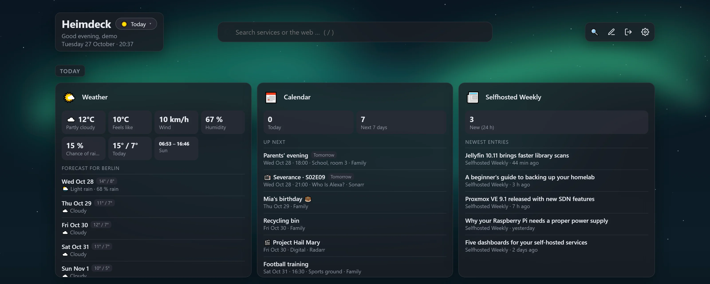
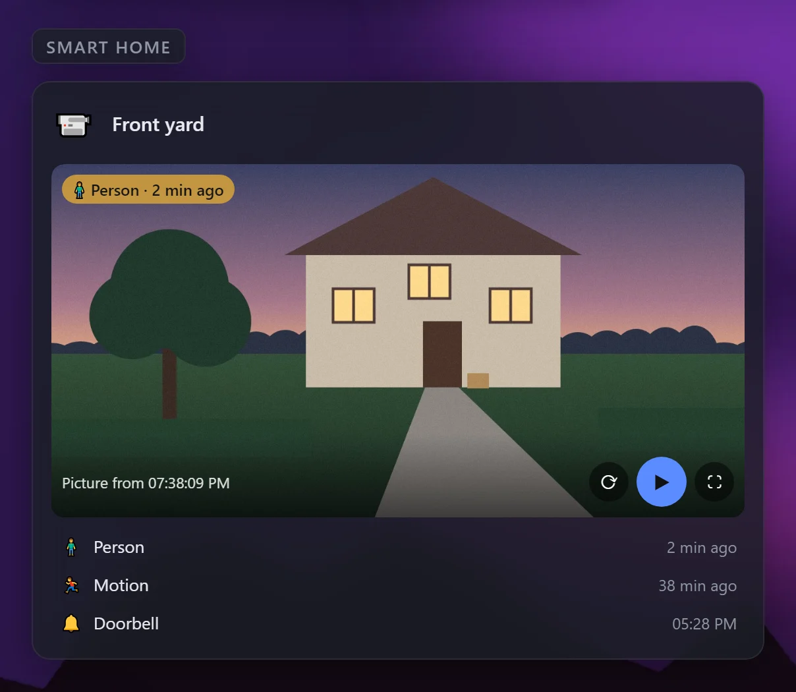

# Unterstützte Dienste

[← Zurück zur Übersicht](../../README.de.md) · [English](../services.md)

- [Alle Integrationen](#alle-integrationen)
- [Info-Kacheln: Wetter, Kalender, RSS, System](#info-kacheln-wetter-kalender-rss-system)
- [Kamera verbinden](#kamera-verbinden)
- [Proxmox verbinden](#proxmox-verbinden)
- [Docker-Kachel](#docker-kachel)
- [Eigene API](#eigene-api)

Kachel hinzufügen, Dienst wählen und Adresse sowie API-Key (oder Benutzer und Passwort) eintragen. Schlüssel werden verschlüsselt gespeichert und gelangen nie in den Browser – Cover und Vorschaubilder, die einen Key brauchen, lädt Heimdeck selbst.


## Alle Integrationen

| Dienst | Live-Daten | Suche | Aktionen |
|---|---|---|---|
| **Medien** | | | |
| Jellyfin | Streams, Bibliotheksgröße | ✓ | |
| Jellyseerr / Overseerr | offene Anfragen, Zähler | ✓ | genehmigen, ablehnen, anfragen |
| Sonarr / Radarr | Warteschlange, Demnächst, Warnungen | | |
| Lidarr | Warteschlange, neue und fehlende Alben, Warnungen | ✓ Künstler | fehlende Alben suchen |
| Bazarr | fehlende Untertitel (Folgen/Filme), gedrosselte Anbieter | ✓ Serien und Filme | fehlende Untertitel suchen |
| Prowlarr | aktive und gestörte Indexer | | |
| Immich | Fotos, Videos, Speicher pro Benutzer; Alben als Dashboard-Hintergrund | ✓ Personen, Dateinamen, optional KI-Suche nach Bildinhalt | |
| PhotoPrism (App-Passwort) | Fotos, Videos, Alben, Personen, zuletzt hinzugefügt; Alben als Dashboard-Hintergrund | ✓ Fotos (Ort, Person, Motiv, Datum) | |
| Audiobookshelf | Hörbücher, Podcasts, Stunden, Weiterhören | ✓ Titel, Autoren, Serien | |
| Kavita | Serien, Bände, Dateien, Weiterlesen | ✓ mit Covern | |
| Komga | Serien, Bücher, angefangene Bücher | ✓ mit Covern | |
| Stash | Szenen, Bilder, Größe | | |
| RomM (API-Token oder Benutzer/Passwort) | Plattformen, Spiele, Spielstände | ✓ | |
| Plex | Streams, Filme/Serien/Musik | ✓ mit Covern | |
| Emby | Streams, Bibliotheksgröße | ✓ | |
| Navidrome | läuft gerade, Titelanzahl, Scan | ✓ Künstler, Alben, Titel mit Covern | |
| Readarr / Bookshelf | Warteschlange, neue und fehlende Bücher | ✓ Autoren | fehlende Bücher suchen |
| Tdarr | Dateien, Transcodes, Warteschlange, gesparter Speicher, laufende Worker | | |
| **Downloads** | | | |
| SABnzbd | Tempo, Warteschlange, Restzeit | | pausieren, fortsetzen |
| NZBGet | Tempo, Warteschlange, Restgröße, Restzeit | | pausieren, fortsetzen |
| qBittorrent, Transmission, Deluge | ↓/↑-Tempo, lädt/seedet, aktive Torrents mit Fortschritt | ✓ Torrents | alle pausieren/fortsetzen |
| MeTube | aktive, fertige, fehlgeschlagene Downloads | | |
| Tubesy (API-Schlüssel aus Tubesy → Konto) | Tempo, aktive, wartende, fehlgeschlagene Downloads, freier Speicher, Größe der Bibliothek, zuletzt fertige Downloads | ✓ Bibliothek; eingefügte URLs herunterladen | Download abbrechen, URL herunterladen |
| **Dokumente** | | | |
| Paperless-ngx | Dokumente, Posteingang | ✓ | |
| Norish (API-Schlüssel) | heute geplante Gerichte, offene Einkäufe, Anzahl Rezepte | ✓ Rezepte | |
| Nextcloud (App-Passwort) | Dateien, Benutzer, aktive Nutzer, freier Speicher (ohne Admin: eigener Speicher) | ✓ Dateien, Kalender, Kontakte, Talk, Notizen, Deck … | |
| **Netzwerk** | | | |
| AdGuard Home | DNS-Anfragen, Blockierquote, Antwortzeit, meistblockierte Domains | ✓ Abfrage-Log | Schutz pausieren/ausschalten, Domain sperren oder freigeben |
| Pi-hole (v6 mit App-Passwort, v5 mit API-Token) | DNS-Anfragen, Blockierquote, Clients | ✓ Abfrage-Log (v6) | Blockieren pausieren, Domain sperren oder freigeben |
| OPNsense (API-Key + Secret) | WAN-Datenrate, RAM, Last, Laufzeit, Gateways, Updates | | |
| UniFi (Network-API-Schlüssel) | Clients, WLAN, Geräte online, Firmware-Updates | ✓ Clients und Geräte | Gerät neu starten |
| FRITZ!Box (TR-064, Benutzer + Passwort) | wählbar: Internet (Verbindung, Datenrate, Leitung, externe IP), Geräte online, Anrufliste mit verpassten Anrufen, Smart Home (DECT-Steckdosen und Thermostate), WLAN-Netze | | DECT-Steckdosen schalten |
| UniFi Protect (API-Schlüssel) | Kameras online, aktuelle Standbilder | ✓ Kameras | |
| Kamera (RTSP und/oder ONVIF) | Standbild mit Timer, Livebild, Ereignisse (Bewegung, Person, Klingel …) mit Bild des Moments | | |
| Speedtest Tracker | Download, Upload, Ping, Verlauf | | Test starten |
| Anubis (Metrik-Port, z. B. `http://anubis:9090`) | Challenges, gelöst, fehlgeschlagen, häufigste Regeln | | |
| **System** | | | |
| Docker (eingebundener Socket) | laufende/gestoppte Container, optional Updates | ✓ Container | optional starten, stoppen, neu starten |
| Proxmox VE (API-Token) | CPU, RAM, Speicher, Laufzeit, Gäste aktiv, Liste der Gäste bzw. Nodes sortiert nach Name, VMID, Status, Auslastung oder Node | ✓ VMs und Container | starten, herunterfahren, neu starten |
| openmediavault (Administrator) | CPU, RAM, Laufzeit, Updates, Dateisysteme, Festplatten-Zustand (S.M.A.R.T.) | | |
| **Smart Home & Energie** | | | |
| Home Assistant (Langlebiges Zugriffstoken) | gewählte Sensoren/Schalter mit eigenen Namen oder Übersicht (Lichter an, Updates, nicht verfügbare Geräte) | ✓ alle Entitäten | umschalten, Szenen und Skripte ausführen, Rollläden, Schlösser |
| ioBroker (REST-API- oder Simple-API-Adapter) | gewählte Datenpunkte mit eigenen Namen oder Adapter-Status | ✓ Datenpunkte | Schalter umschalten |
| evcc | PV, Haus, Netz, Batterie, Ladepunkte (aktualisiert alle 5 s) | | Lademodus wechseln (Aus, PV, Min+PV, Schnell, Smart) |
| WLED | An/Aus, Helligkeit, Effekt, Presets | ✓ Presets | An/Aus, Helligkeit, Preset anwenden |
| Shelly (lokal, Gen1 bis Gen4) | Leistung, Energie, Temperatur, Luftfeuchte, Akku, WLAN, Firmware-Updates | | Relais und Lichter schalten, Rollläden öffnen/stoppen/schließen |
| **Sonstige** | | | |
| Eigene API | beliebige Werte, Liste und Knöpfe aus einer JSON-Antwort | ✓ wenn eingerichtet | eigene Knöpfe |
| Webhook | Meldungen, die andere Dienste an die eigene Adresse der Kachel schicken (JSON, Formular, Text, Uptime Kuma) | | Knöpfe, die Webhooks aufrufen (Shelly, Home Assistant, Node-RED, IFTTT …) |
| Wetter | aktuelles Wetter und 3–7 Tage Vorhersage für jeden Ort (Open-Meteo, ohne Key), Hinweise zu Sturm und UV | | |
| Kalender | anstehende Termine aus iCal-Links (Nextcloud, Google, Outlook, Proton …), auch wiederkehrende, dazu neue Folgen und Filme aus deinen Sonarr- und Radarr-Kacheln | | |
| RSS-Feed | neueste Einträge von RSS-/Atom-Feeds (Nachrichten, Blogs, Release Notes, YouTube-Kanäle) | | |
| System (Admins) | CPU, Arbeitsspeicher, Last, Temperatur, Netzwerk und Lese-/Schreibtempo, Laufzeit, Speicherplatz des Heimdeck-Rechners (Linux) | | |
| JDownloader, Zoraxy, Portainer, … | Online-Status | | |

Jede Kachel kann außerdem „Nur Link“ sein und zeigt trotzdem an, ob der Dienst erreichbar ist.

Dein Dienst fehlt? Nimm die Kachel [Eigene API](#eigene-api) oder [eröffne ein Issue](https://github.com/MrLuigi938/heimdeck/issues).

## Info-Kacheln: Wetter, Kalender, RSS, System


<sub>Demodaten</sub>

Diese Kacheln brauchen keinen eigenen Dienst:

- **Wetter**: einen Ort (`Berlin`, `Freiburg im Breisgau`) oder Koordinaten (`52.52, 13.40`) eintragen. Die Daten kommen von [Open-Meteo](https://open-meteo.com), höchstens alle 10 Minuten abgefragt.
- **Kalender**: eine iCal-Adresse pro Zeile, optional mit Namen (`Familie = https://…`; `webcal://` geht auch). Private Kalender-Links werden verschlüsselt gespeichert. Mit *Neue Folgen und Filme aus Sonarr und Radarr zeigen* kommen die Neuerscheinungen deiner eigenen Sonarr- und Radarr-Kacheln dazu. Ein Kalender, der nur mit „beschäftigt“ geteilt ist, zeigt seine Termine als *Beschäftigt* mit einem Hinweis, ihn mit allen Details zu teilen. Kalender werden höchstens alle 15 Minuten gelesen.
- **RSS-Feed**: ein Feed pro Zeile; mehrere Feeds werden nach Datum gemischt. Steht die Anzahl der Einträge auf *automatisch*, zeigt eine Kachel im freien Raster so viele, wie hineinpassen – höher ziehen zeigt mehr. Auch die Listen von Kalender und Wetter passen sich ihrer Kachel an.
- **System** (nur Admins): die Auslastung des Rechners, auf dem Heimdeck läuft. Im Docker-Container sind CPU, Arbeitsspeicher, Datenträger-Tempo und Temperatur die des Hosts, das Netzwerk das des Containers (für das des Hosts `network_mode: host`); weitere Laufwerke in den Container einbinden und auf der Kachel eintragen. Im Proxmox-LXC zeigt sie den Container – für den ganzen Server die Proxmox-Kachel nehmen.

## ioBroker verbinden

ioBroker hat keine eigene Daten-Schnittstelle – sie kommt von einem Adapter:

1. In ioBroker Admin → **Adapter** den Adapter **REST API** installieren (eine Instanz, Standard-Einstellungen).
2. In Heimdeck als Adresse `http://<ioBroker-IP>:8093` eintragen. Die Admin-Oberfläche auf Port 8081 liefert keine Daten. Läuft der Adapter im Web-Adapter, lautet die Adresse `http://<ioBroker-IP>:8082/rest-api`; der ältere Simple-API-Adapter (Port 8087) geht auch.
3. Neben „Datenpunkte auf der Kachel“ auf **Auswählen** klicken, Datenpunkte suchen und anhaken – IDs abtippen ist nicht nötig. Ohne Auswahl zeigt die Kachel den Status deiner Adapter.

Entitäten von Home Assistant wählst du genauso aus. Unter der Auswahl bekommt jeder Eintrag ein Feld für **deinen eigenen Namen** – praktisch, wenn Entitäten z. B. `sensor.0x00158d0001a2b3c4_temperature` heißen. Leer lassen, um den Namen aus dem Dienst zu behalten.

## Kamera verbinden


<sub>Demo-Daten mit gezeichnetem Bild</sub>

Die Kachel **Kamera (RTSP/ONVIF)** funktioniert mit fast jeder IP-Kamera im eigenen Netz – ohne Cloud und ohne Zusatzsoftware. Das Video läuft über Heimdeck; der Browser bekommt Adresse und Passwort der Kamera nie zu sehen.

1. In der App oder Weboberfläche der Kamera **RTSP** einschalten (oft unter *Netzwerk*, *Erweitert* oder *NVR/RTSP*) und die Adresse notieren, z. B. `rtsp://192.168.1.50:554/live`. Viele Kameras haben einen kleineren **Substream** – der lädt schneller.
2. Die Kachel *Kamera (RTSP/ONVIF)* hinzufügen, RTSP-Adresse und das Kamera-Konto eintragen (nicht das Cloud-Konto der App) und *Testen* klicken.
3. Kann die Kamera **ONVIF**, auch deren Adresse eintragen (z. B. `http://192.168.1.50:8000`): Heimdeck findet Stream und Standbild dann selbst und bekommt die Ereignisse der Kamera (Bewegung, Person, Fahrzeug, Klingel …).

Auf der Kachel:

- **Standbild**: beim Laden des Dashboards, alle 10 oder 30 Sekunden, jede Minute, alle 5 oder 15 Minuten – oder nur auf Klick. Ohne Standbild-Adresse nimmt Heimdeck das Bild aus dem Stream (das neueste Schlüsselbild).
- **▶ Livebild**: der Stream läuft direkt in der Kachel, ⛶ zeigt ihn im Vollbild. Er stoppt, sobald der Tab im Hintergrund ist, spätestens nach 30 Minuten. Alle Zuschauer teilen sich eine Verbindung zur Kamera.
- **Ereignisse**: *automatisch* nimmt die ONVIF-Ereignisse der Kamera. Für Kameras, die nur RTSP können, erkennt Heimdeck mit *aus dem Stream erkennen* Bewegung selbst (daran, wie stark sich das Bild ändert, mit einstellbarer Empfindlichkeit) – der Stream läuft dann dauernd. Zu jedem Ereignis bleibt ein Bild des Moments; die neuesten stehen unter dem Bild, das letzte als Hinweis im Bild. Ereignisse liegen im Arbeitsspeicher (die letzten 20 pro Kamera) und sind nach einem Neustart weg.
- **Benachrichtigungen**: *Bei Ereignissen benachrichtigen* ankreuzen – über deine Kanäle unter *Einstellungen → Benachrichtigungen*, höchstens alle 5 Minuten pro Kamera.

Das Video wird so weitergegeben, wie es kommt (kein Umrechnen, kaum CPU): **H.264** läuft in jedem Browser, **H.265** in Chrome, Edge und Safari, aber nicht in Firefox – dort den H.264-Substream wählen. Ton wird nicht abgespielt. **Akku-Kameras**: Livebild, kurze Aktualisierungszeiten und die Bewegungserkennung im Stream halten die Kamera wach und leeren den Akku – dort besser *nur auf Klick* und ONVIF-Ereignisse nehmen.

## Proxmox verbinden

1. In Proxmox: Rechenzentrum → Berechtigungen → **API-Token** → Token anlegen (z. B. `root@pam`, Name `heimdeck`) und **„Privilegtrennung“ abwählen** – sonst hat der Token keine eigenen Rechte und die Kachel bleibt leer. Mit Privilegtrennung dem Token selbst die Rolle **PVEAuditor** auf `/` geben (Rechenzentrum → Berechtigungen → Hinzufügen → API-Token-Berechtigung), zusätzlich **PVEVMUser** zum Starten und Stoppen von Gästen.
2. In Heimdeck: Startseite → **Proxmox verbinden** (oder Proxmox-Kachel anlegen) und das Token im Format `benutzer@pam!name=geheimnis` eintragen.

Danach findet 🔍 die Dienste in deinen VMs und Containern: am Namen bzw. an den Tags (z. B. `jellyfin`, `adguard`, `paperless-ngx` – so heißen auch die Container der Proxmox-Community-Skripte), mit der IP-Adresse des Gasts und dem üblichen Port. VMs brauchen dafür den QEMU-Gast-Agenten.

## Docker-Kachel

Zeigt laufende und gestoppte Container. In den Einstellungen unter „Docker“ lassen sich zwei Dinge einschalten (beide standardmäßig aus):

- **Nach Container-Updates suchen**: alle 6 Stunden wird das Image jedes Containers mit der Registry verglichen (nur lesen, es wird nichts aktualisiert).
- **Container starten, stoppen und neu starten**: Knöpfe auf der Kachel und in der Suche. Achtung: Jeder, der im Dashboard angemeldet ist, kann dann deine Container steuern. Mit einem Socket-Proxy braucht es dafür `POST=1` und `CONTAINERS=1`.

## Eigene API

Für alles ohne eigene Integration: Kachel „Eigene API“ wählen, Adresse eintragen und beschreiben, was angezeigt werden soll. Beispiel für eine Antwort wie `{"cpu": 0.42, "disk": {"used": 550000000000}, "devices": [{"name": "NAS", "online": true}]}`:

```
Werte:
  CPU = cpu | anteil
  Belegt = disk.used | bytes
  Online = devices[online=true].# | zahl warn<1
Liste:          devices
Listeneintrag:  title = name
                badge = online | janein
Knöpfe:         Neu starten = POST /api/restart
```

- **Pfade**: `a.b.c`, `liste[0]`, `liste[-1]` (letztes), `liste.#` (Anzahl), `liste[feld=wert]` (filtern, auch `!=`, `>`, `<`).
- **Formate**: `text`, `zahl[:Nachkommastellen]`, `bytes`, `prozent`, `anteil` (0–1 → %), `dauer` (Sekunden), `datum`, `seit`, `janein`. Dahinter eine Einheit (`zahl:1 °C`) und Farben (`ok=up`, `warn>80`, `bad<10`). Englische Namen (`number`, `percent`, `ratio`, `duration`, `date`, `since`, `bool`) gehen ebenso.
- **Listeneintrag**: `title`, `subtitle`, `badge`, `progress`, `url`; mehrere Pfade mit `+` verbinden (`subtitle = artist + album`).
- **Suche**: optional ein Pfad mit `{q}` als Platzhalter (z. B. `/api/search?q={q}`), dann ist die API Teil der gemeinsamen Suche.
- **Header** wie `Authorization: Bearer …` werden verschlüsselt gespeichert.

Ohne eingetragene Werte zeigt die Kachel die Antwort an – praktisch, um die Pfade zu finden.

