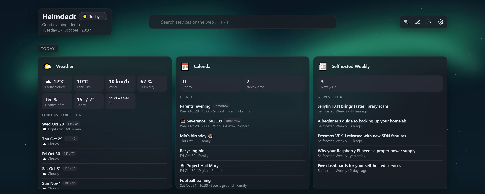

# Supported services

[← Back to the README](../README.md) · [Deutsch](de/dienste.md)

- [All integrations](#all-integrations)
- [Info tiles: weather, calendar, RSS, system](#info-tiles-weather-calendar-rss-system)
- [Connecting Proxmox](#connecting-proxmox)
- [Docker tile](#docker-tile)
- [Custom API tile](#custom-api-tile)

Add a tile, choose the service and enter its address and API key (or user and password). Keys are stored encrypted and never reach the browser – covers and thumbnails that need a key are loaded by Heimdeck itself.


## All integrations

| Service | Live data | Search | Actions |
|---|---|---|---|
| **Media** | | | |
| Jellyfin | streams, library size | ✓ | |
| Jellyseerr / Overseerr | pending requests, counters | ✓ | approve, decline, request |
| Sonarr / Radarr | queue, upcoming, warnings | | |
| Lidarr | queue, new and missing albums, warnings | ✓ artists | search missing albums |
| Bazarr | missing subtitles (episodes/movies), throttled providers | ✓ series and movies | search missing subtitles |
| Prowlarr | active and failing indexers | | |
| Immich | photos, videos, storage per user | ✓ people, file names, optional smart search by image content | |
| PhotoPrism (app password) | photos, videos, albums, people, recently added | ✓ photos (place, person, subject, date) | |
| Audiobookshelf | audiobooks, podcasts, hours, continue listening | ✓ titles, authors, series | |
| Kavita | series, volumes, files, continue reading | ✓ with covers | |
| Komga | series, books, books in progress | ✓ with covers | |
| Stash | scenes, images, size | | |
| RomM (API token or user/password) | platforms, games, save states | ✓ | |
| Plex | streams, movies/shows/music | ✓ with covers | |
| Emby | streams, library size | ✓ | |
| Navidrome | now playing, track count, scan | ✓ artists, albums, tracks with covers | |
| Readarr / Bookshelf | queue, new and missing books | ✓ authors | search missing books |
| Tdarr | files, transcodes, queue, space saved, active workers | | |
| **Downloads** | | | |
| SABnzbd | speed, queue, time left | | pause, resume |
| NZBGet | speed, queue, size left, time left | | pause, resume |
| qBittorrent, Transmission, Deluge | ↓/↑ speed, downloading/seeding, active torrents with progress | ✓ torrents | pause/resume all |
| MeTube | active, finished, failed downloads | | |
| Tubesy (API key from Tubesy → Account) | speed, active, queued, failed downloads, free space | ✓ library; paste a URL to download | cancel download, download URL |
| **Documents** | | | |
| Paperless-ngx | documents, inbox | ✓ | |
| Norish (API key) | meals planned today, open groceries, number of recipes | ✓ recipes | |
| Nextcloud (app password) | files, users, active users, free space (without admin: own storage) | ✓ files, calendar, contacts, Talk, notes, Deck … | |
| **Network** | | | |
| AdGuard Home | DNS queries, block rate, response time, top blocked domains | ✓ query log | pause/disable protection, block or allow a domain |
| Pi-hole (v6 with app password, v5 with API token) | DNS queries, block rate, clients | ✓ query log (v6) | pause blocking, block or allow a domain |
| OPNsense (API key + secret) | WAN throughput, RAM, load, uptime, gateways, updates | | |
| UniFi (Network API key) | clients, Wi-Fi, devices online, firmware updates | ✓ clients and devices | restart device |
| FRITZ!Box (TR-064, user + password) | choose: internet (connection, data rate, line, public IP), devices online, call list with missed calls, smart home (DECT sockets and thermostats), Wi-Fi networks | | switch DECT sockets |
| UniFi Protect (API key) | cameras online, current snapshots | ✓ cameras | |
| Speedtest Tracker | download, upload, ping, history | | start test |
| Anubis (metrics port, e.g. `http://anubis:9090`) | challenges, solved, failed, top rules | | |
| **System** | | | |
| Docker (mounted socket) | running/stopped containers, optional updates | ✓ containers | optional start, stop, restart |
| Proxmox VE (API token) | CPU, RAM, storage, uptime, active guests, busiest and stopped guests or nodes | ✓ VMs and containers | start, shut down, reboot |
| openmediavault (admin user) | CPU, RAM, uptime, updates, file systems, disk health (S.M.A.R.T.) | | |
| **Smart home & energy** | | | |
| Home Assistant (long-lived access token) | chosen sensors/switches with your own names, or overview (lights on, updates, unavailable devices) | ✓ all entities | toggle, run scenes and scripts, covers, locks |
| ioBroker (REST API or Simple API adapter) | chosen data points with your own names, or adapter status | ✓ data points | toggle switches |
| evcc | PV, home, grid, battery, charge points (refreshes every 5 s) | | change charge mode (off, PV, min+PV, fast, smart) |
| WLED | on/off, brightness, effect, presets | ✓ presets | on/off, brightness, apply preset |
| Shelly (local, Gen1 to Gen4) | power, energy, temperature, humidity, battery, Wi-Fi, firmware updates | | switch relays and lights, open/stop/close covers |
| **Other** | | | |
| Custom API | any values, list and buttons from a JSON response | ✓ if configured | custom buttons |
| Webhook | messages other services post to the tile's own address (JSON, form, text, Uptime Kuma) | | buttons that call webhooks (Shelly, Home Assistant, Node-RED, IFTTT …) |
| Weather | current weather and a 3–7 day forecast for any place (Open-Meteo, no key), storm and UV hints | | |
| Calendar | upcoming events from iCal links (Nextcloud, Google, Outlook, Proton …), repeating ones too, plus new episodes and films from your Sonarr and Radarr tiles | | |
| RSS feed | newest entries of RSS/Atom feeds (news, blogs, release notes, YouTube channels) | | |
| System (admins) | CPU, memory, load, temperature, network and disk throughput, uptime, disk space of the Heimdeck host (Linux) | | |
| JDownloader, Zoraxy, Portainer, … | online status | | |

Missing a service? Use the [custom API tile](#custom-api-tile) or [open an issue](https://github.com/MrLuigi938/heimdeck/issues).

## Info tiles: weather, calendar, RSS, system


<sub>Demo data</sub>

These tiles need no service of their own:

- **Weather**: enter a place (`Berlin`, `Springfield, Illinois`) or coordinates (`52.52, 13.40`). Data from [Open-Meteo](https://open-meteo.com), fetched at most every 10 minutes.
- **Calendar**: one iCal address per line, optionally named (`Family = https://…`; `webcal://` works too). Private calendar links are stored encrypted. Tick *Show new episodes and films from Sonarr and Radarr* to add the releases of your own Sonarr and Radarr tiles. A calendar shared "busy only" shows its events as *Busy* with a hint to share it with all details. Calendars are read at most every 15 minutes.
- **RSS feed**: one feed per line; several feeds are mixed by date.
- **System** (admins only): the load of the machine Heimdeck runs on. In a Docker container CPU, memory, disk speed and temperature are the host's, the network is the container's (use `network_mode: host` for the host's); mount more drives into the container and list them on the tile. In a Proxmox LXC it shows the container – use the Proxmox tile for the whole server.

## Connecting ioBroker

ioBroker has no data interface of its own – it comes from an adapter:

1. In ioBroker Admin → **Adapters**, install **REST API** (one instance, default settings).
2. In Heimdeck, enter `http://<ioBroker-IP>:8093` as the address. The admin interface on port 8081 does not provide data. If the adapter runs inside the web adapter, use `http://<ioBroker-IP>:8082/rest-api`; the older Simple API adapter (port 8087) works as well.
3. Click **Choose** next to “Data points on the tile” to search your data points and tick the ones you want – no need to type IDs. Without a selection the tile shows the status of your adapters.

Home Assistant entities are chosen the same way. Below the selection every entry gets a field for **your own name** – handy when entities are called something like `sensor.0x00158d0001a2b3c4_temperature`. Leave it empty to keep the name from the service.

## Connecting Proxmox

1. In Proxmox: Datacenter → Permissions → **API Tokens** → add a token (e.g. `root@pam`, name `heimdeck`) and **untick “Privilege Separation”** – otherwise the token has no rights of its own and the tile stays empty. With privilege separation, give the token itself the role **PVEAuditor** on `/` (Datacenter → Permissions → Add → API Token Permission), plus **PVEVMUser** to start and stop guests.
2. In Heimdeck: start page → **Connect Proxmox** (or add a Proxmox tile) and enter the token as `user@pam!name=secret`.

After that, 🔍 finds the services running in your VMs and containers: by name or tags (e.g. `jellyfin`, `adguard`, `paperless-ngx` – the containers of the Proxmox community scripts are named like this), with the IP address of the VM or container and the usual port. VMs need the QEMU guest agent for this.

## Docker tile

Shows running and stopped containers. Two extras can be enabled in the settings under “Docker” (both off by default):

- **Check for container updates**: every 6 hours each container's image is compared with its registry (read-only – nothing is updated).
- **Start, stop and restart containers**: buttons on the tile and in the search. Note: everyone who can log in to the dashboard can then control your containers. With a socket proxy this needs `POST=1` and `CONTAINERS=1`.

## Custom API tile

For everything without its own integration: choose the tile “Custom API”, enter the address and describe what to show. Example for a response like `{"cpu": 0.42, "disk": {"used": 550000000000}, "devices": [{"name": "NAS", "online": true}]}`:

```
Values:
  CPU = cpu | ratio
  Used = disk.used | bytes
  Online = devices[online=true].# | number warn<1
List:       devices
List item:  title = name
            badge = online | bool
Buttons:    Restart = POST /api/restart
```

- **Paths**: `a.b.c`, `list[0]`, `list[-1]` (last), `list.#` (count), `list[field=value]` (filter, also `!=`, `>`, `<`).
- **Formats**: `text`, `number[:decimals]`, `bytes`, `percent`, `ratio` (0–1 → %), `duration` (seconds), `date`, `since`, `bool`. Add a unit after it (`number:1 °C`) and colors (`ok=up`, `warn>80`, `bad<10`).
- **List items**: `title`, `subtitle`, `badge`, `progress`, `url`; combine paths with `+` (`subtitle = artist + album`).
- **Search**: optionally a path with `{q}` as placeholder (e.g. `/api/search?q={q}`) makes the API part of the global search.
- **Headers** such as `Authorization: Bearer …` are stored encrypted.

Without any values the tile shows the raw response – handy for finding the paths.
