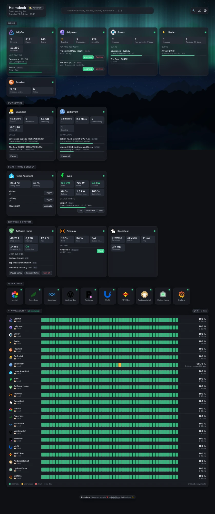

# Supported services

[← Back to the README](../README.md) · [Deutsch](de/dienste.md)

- [All integrations](#all-integrations)
- [Connecting Proxmox](#connecting-proxmox)
- [Docker tile](#docker-tile)
- [Custom API tile](#custom-api-tile)

Add a tile, choose the service and enter its address and API key (or user and password). Keys are stored encrypted and never reach the browser – covers and thumbnails that need a key are loaded by Heimdeck itself.

<details>
<summary><b>Example: a dashboard with many integrations</b> (demo data)</summary>


</details>

## All integrations

| Service | Live data | Search | Actions |
|---|---|---|---|
| **Media** | | | |
| Jellyfin | streams, library size | ✓ | |
| Jellyseerr / Overseerr | pending requests, counters | ✓ | approve, decline, request |
| Sonarr / Radarr | queue, upcoming, warnings | | |
| Lidarr | queue, new and missing albums, warnings | ✓ artists | search missing albums |
| Bazarr | missing subtitles (episodes/movies), throttled providers | ✓ series and movies | search missing subtitles |
| Prowlarr | active and failing indexers | | |
| Immich | photos, videos, storage per user | ✓ people, file names, optional smart search by image content | |
| Audiobookshelf | audiobooks, podcasts, hours, continue listening | ✓ titles, authors, series | |
| Kavita | series, volumes, files, continue reading | ✓ with covers | |
| Komga | series, books, books in progress | ✓ with covers | |
| Stash | scenes, images, size | | |
| RomM (API token or user/password) | platforms, games, save states | ✓ | |
| Plex | streams, movies/shows/music | ✓ with covers | |
| Emby | streams, library size | ✓ | |
| Navidrome | now playing, track count, scan | ✓ artists, albums, tracks with covers | |
| Readarr / Bookshelf | queue, new and missing books | ✓ authors | search missing books |
| Tdarr | files, transcodes, queue, space saved, active workers | | |
| **Downloads** | | | |
| SABnzbd | speed, queue, time left | | pause, resume |
| NZBGet | speed, queue, size left, time left | | pause, resume |
| qBittorrent, Transmission, Deluge | ↓/↑ speed, downloading/seeding, active torrents with progress | ✓ torrents | pause/resume all |
| MeTube | active, finished, failed downloads | | |
| Tubesy (API key from Tubesy → Account) | speed, active, queued, failed downloads, free space | ✓ library; paste a URL to download | cancel download, download URL |
| **Documents** | | | |
| Paperless-ngx | documents, inbox | ✓ | |
| Nextcloud (app password) | files, users, active users, free space (without admin: own storage) | ✓ files, calendar, contacts, Talk, notes, Deck … | |
| **Network** | | | |
| AdGuard Home | DNS queries, block rate, response time, top blocked domains | ✓ query log | pause/disable protection, block or allow a domain |
| Pi-hole (v6 with app password, v5 with API token) | DNS queries, block rate, clients | ✓ query log (v6) | pause blocking, block or allow a domain |
| OPNsense (API key + secret) | WAN throughput, RAM, load, uptime, gateways, updates | | |
| UniFi (Network API key) | clients, Wi-Fi, devices online, firmware updates | ✓ clients and devices | restart device |
| Speedtest Tracker | download, upload, ping, history | | start test |
| Anubis (metrics port, e.g. `http://anubis:9090`) | challenges, solved, failed, top rules | | |
| **System** | | | |
| Docker (mounted socket) | running/stopped containers, optional updates | ✓ containers | optional start, stop, restart |
| Proxmox VE (API token) | CPU, RAM, active guests, nodes or stopped guests | ✓ VMs and containers | start, shut down, reboot |
| **Smart home & energy** | | | |
| Home Assistant (long-lived access token) | chosen sensors/switches or overview (lights on, updates, unavailable devices) | ✓ all entities | toggle, run scenes and scripts, covers, locks |
| ioBroker (REST API or Simple API adapter) | chosen data points or adapter status | ✓ data points | toggle switches |
| evcc | PV, home, grid, battery, charge points | | change charge mode (off, PV, min+PV, fast) |
| **Other** | | | |
| Custom API | any values, list and buttons from a JSON response | ✓ if configured | custom buttons |
| JDownloader, FRITZ!Box, Zoraxy, Portainer, … | online status | | |

Missing a service? Use the [custom API tile](#custom-api-tile) or [open an issue](https://github.com/MrLuigi938/heimdeck/issues).

## Connecting Proxmox

1. In Proxmox: Datacenter → Permissions → **API Tokens** → add a token (e.g. `root@pam`, name `heimdeck`). Give it the role **PVEAuditor** to view, plus **PVEVMUser** if you want to start and stop guests from Heimdeck.
2. In Heimdeck: start page → **Connect Proxmox** (or add a Proxmox tile) and enter the token as `user@pam!name=secret`.

After that, 🔍 finds the services running in your VMs and containers: by name or tags (e.g. `jellyfin`, `adguard`, `paperless-ngx` – the containers of the Proxmox community scripts are named like this), with the guest's IP address and the usual port. VMs need the QEMU guest agent for this.

## Docker tile

Shows running and stopped containers. Two extras can be enabled in the settings under “Docker” (both off by default):

- **Check for container updates**: every 6 hours each container's image is compared with its registry (read-only – nothing is updated).
- **Start, stop and restart containers**: buttons on the tile and in the search. Note: everyone who can log in to the dashboard can then control your containers. With a socket proxy this needs `POST=1` and `CONTAINERS=1`.

## Custom API tile

For everything without its own integration: choose the tile “Custom API”, enter the address and describe what to show. Example for a response like `{"cpu": 0.42, "disk": {"used": 550000000000}, "devices": [{"name": "NAS", "online": true}]}`:

```
Values:
  CPU = cpu | ratio
  Used = disk.used | bytes
  Online = devices[online=true].# | number warn<1
List:       devices
List item:  title = name
            badge = online | bool
Buttons:    Restart = POST /api/restart
```

- **Paths**: `a.b.c`, `list[0]`, `list[-1]` (last), `list.#` (count), `list[field=value]` (filter, also `!=`, `>`, `<`).
- **Formats**: `text`, `number[:decimals]`, `bytes`, `percent`, `ratio` (0–1 → %), `duration` (seconds), `date`, `since`, `bool`. Add a unit after it (`number:1 °C`) and colors (`ok=up`, `warn>80`, `bad<10`).
- **List items**: `title`, `subtitle`, `badge`, `progress`, `url`; combine paths with `+` (`subtitle = artist + album`).
- **Search**: optionally a path with `{q}` as placeholder (e.g. `/api/search?q={q}`) makes the API part of the global search.
- **Headers** such as `Authorization: Bearer …` are stored encrypted.

Without any values the tile shows the raw response – handy for finding the paths.
